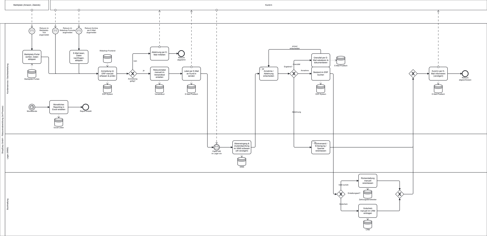
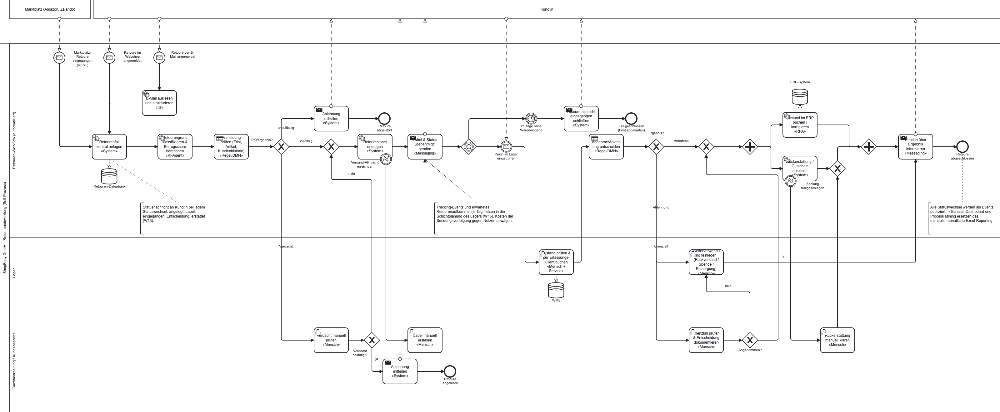

# Sprint 1 – Business Process Management (Abgabe 20.10., 11:30)

## Inhalt der Abgabe
- `bpmn/ist-prozess.bpmn` – Ist-Prozess, drei Eingangskanäle (Webshop, Marktplatz, E-Mail), drei Lanes und zwei externe Pools (Kund:in, Marktplatz); Bild: [`ist-prozess.png`](ist-prozess.png)
- `bpmn/soll-prozess.bpmn` – Soll-Prozess mit Umsetzungsart je Aktivität; Bild: [`soll-prozess.png`](soll-prozess.png)
- `docs/sprint1/schwachstellenanalyse.md`
- `docs/sprint1/kpi-katalog.md` – Kern-KPIs K1–K8 (u. a. Durchlaufzeit gesamt und intern, Fehlerquote in drei Teilen) und Zusatz-KPIs K9–K19, mit Event-Log-Schema, Zuordnung zu den Modellelementen und Vorlage für Sprint 3
- `docs/sprint1/soll-prozess-realisierung.md` – Begründung der Umsetzungsart je Soll-Aktivität

## Ist-Prozess
Die zehn Schritte der Aufgabenstellung sind im Pool ShopEasy in drei Lanes modelliert (Kundenservice / Sachbearbeitung, Lager, Buchhaltung). Kund:in und Marktplatz sind externe Teilnehmer und als eingeklappte Pools dargestellt; sie kommunizieren über Nachrichtenflüsse (Anmeldung, Label, Paket, Ablehnung, Information). Die drei Startereignisse münden über kanalspezifische Schritte in die Erfassung im ERP. Danach entscheidet das Gateway „Anmeldung gültig?“, ob die Retoure (z. B. wegen abgelaufener Frist) per E-Mail abgelehnt wird. Die Entscheidung nach dem Wareneingang hat die Ausgänge Annahme, Ablehnung und Grenzfall; Grenzfälle laufen per E-Mail-Eskalation zurück in die Entscheidung. Bei der Rückerstattung (Schritt 8) entscheidet ein Gateway zwischen Geld über den Zahlungsdienstleister und Gutschein im CRM.

Die beteiligten Systeme aus der Aufgabenstellung (Webshop-Frontend, Marktplatz-Portale, ERP, WMS, CRM, Zahlungsdienstleister, E-Mail-Postfach, Excel) sind als Datenspeicher an den Aufgaben modelliert, die sie nutzen; zusätzlich das Versandtool aus Schritt 3. Das monatliche Reporting (Schritt 10) ist ein eigener Ablauf mit Timer-Startereignis, weil es nicht Teil des einzelnen Retourenfalls ist.

**Aufgabentypen im Ist-Modell:** Schritte, die an einem System ausgeführt werden (ERP, WMS, E-Mail, Excel), sind als undefinierte Aufgabe (`task`) mit Datenspeichern modelliert. Nur die Entscheidung und die Veranlassung von Rückversand, Entsorgung oder Spende sind `manualTask`. Die Vorlesung grenzt den Manual Task als Tätigkeit ohne IT-Unterstützung ab; ein User Task würde eine Process Engine voraussetzen, die es im Ist-Prozess nicht gibt.

## Soll-Prozess – wichtigste Änderungen
1. Alle Kanäle münden in einen zentralen Retourenfall (REST/Messaging).
2. Regelbasierte Prüfung (DMN) und KI-Klassifikation mit Betrugsscore vor der Freigabe.
3. Automatische Labelerzeugung; Status-Nachrichten an Kund:in bei jedem Statuswechsel.
4. Eventbasiertes Warten auf den Wareneingang mit Timer (21 Tage).
5. Zustandserfassung am Wareneingang über gRPC-Service.
6. Entscheidung per DMN; Grenzfälle als dokumentierte menschliche Aufgabe.
7. Bestandsbuchung (RPA) und Rückerstattung (Service) parallel; ein XOR-Gateway führt Rückerstattung und manuelle Klärung zusammen, damit der parallele Join nicht blockiert.
8. Fehlerbehandlung: Ausfall der Versand-API und fehlgeschlagene Zahlung führen zu manuellen Aufgaben.
9. Auf jede Entscheidung einer Person folgt ein Gateway mit Bedingung (vorbereitet für Camunda 8 in Sprint 4).
10. Events ersetzen das manuelle Excel-Reporting.

Die Wahl der Umsetzungsart je Aktivität (mit Begründung, verworfener Alternative und Fehlerfall) steht in `docs/sprint1/soll-prozess-realisierung.md`. Von 19 Aufgaben laufen 13 automatisch, eine ist hybrid (Mensch + gRPC-Service), fünf sind menschlich (davon drei Ausnahmepfade).

## Umsetzungsarten im Soll-Prozess

| Art | Aktivitäten |
|---|---|
| System/Service | Fall anlegen, Label erzeugen, Statusnachrichten, Rückerstattung |
| Regeln (DMN) | Anmeldung prüfen, Annahme/Ablehnung entscheiden |
| Mensch + Service (gRPC) | Zustand prüfen und buchen |
| Mensch | Verdacht prüfen, Grenzfall prüfen, Weiterverwendung festlegen, Fallback-Aufgaben |
| RPA | Bestand im ERP buchen/korrigieren |
| KI | E-Mail auslesen, Retourengrund klassifizieren, Betrugsscore |

## Offene Punkte
- Modelle in Camunda Modeler öffnen und das Layout prüfen. Die Diagramme wurden aus `tools/gen_bpmn.py` erzeugt und mit bpmn-js zu PNG gerendert; die Darstellung im Modeler kann in Details abweichen.
- Startpunkt der „8–12 Tage“ mit dem Dozenten klären (ab Anmeldung oder ab Wareneingang); K1a und K1b decken beide Varianten ab.
- Annahmen prüfen: Versandtool und Zahlungsdienstleister haben eine API, das ERP nicht.
- Aktivitätsnamen des KPI-Katalogs mit der Log-Datei aus Sprint 3 abgleichen.
- Team prüft alle Inhalte und trägt Änderungen in `AI-USAGE.md` ein.
