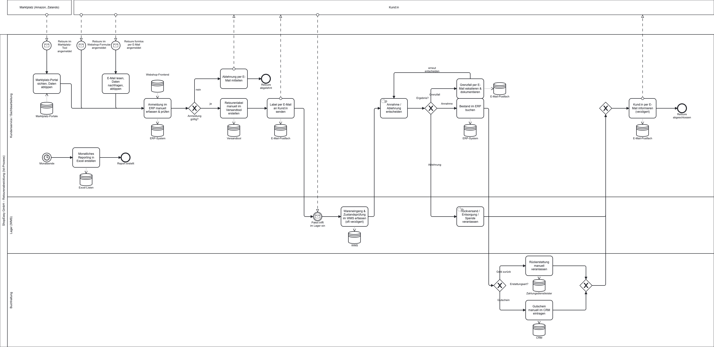
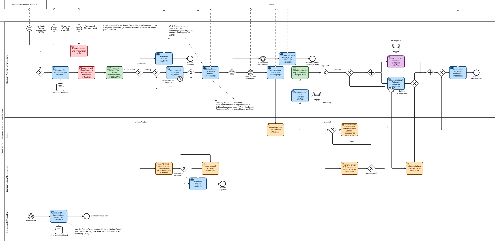

# Sprint 1 – Business Process Management (Abgabe 20.10., 11:30)

## Inhalt der Abgabe
- `sprint1-bpm/ist-prozess.bpmn` – Ist-Prozess, drei Eingangskanäle (Webshop, Marktplatz, E-Mail), drei Lanes und zwei externe Pools (Kund:in, Marktplatz); Bild: [`ist-prozess.png`](ist-prozess.png)
- `sprint1-bpm/soll-prozess.bpmn` – Soll-Prozess mit Umsetzungsart je Aktivität; Bild: [`soll-prozess.png`](soll-prozess.png)
- `sprint1-bpm/schwachstellenanalyse.md`
- `sprint1-bpm/kpi-katalog.md` – Kern-KPIs K1–K8 (u. a. Durchlaufzeit gesamt und intern, Fehlerquote in drei Teilen) und Zusatz-KPIs K9–K21, mit Event-Log-Schema, Zuordnung zu den Modellelementen und Vorlage für Sprint 3
- `sprint1-bpm/soll-prozess-realisierung.md` – Begründung der Umsetzungsart je Soll-Aktivität

## Ist-Prozess
Die zehn Schritte der Aufgabenstellung sind im Pool ShopEasy in drei Lanes modelliert (Kundenservice / Sachbearbeitung, Lager, Buchhaltung). Kund:in und Marktplatz sind externe Teilnehmer und als eingeklappte Pools dargestellt; sie kommunizieren über Nachrichtenflüsse (Anmeldung, Label, Paket, Ablehnung, Information). Die drei Startereignisse münden über kanalspezifische Schritte in die Erfassung im ERP. Danach entscheidet das Gateway „Anmeldung gültig?“, ob die Retoure (z. B. wegen abgelaufener Frist) per E-Mail abgelehnt wird. Die Entscheidung nach dem Wareneingang hat die Ausgänge Annahme, Ablehnung und Grenzfall; Grenzfälle laufen per E-Mail-Eskalation zurück in die Entscheidung. Bei der Rückerstattung (Schritt 8) entscheidet ein Gateway zwischen Geld über den Zahlungsdienstleister und Gutschein im CRM.

Die beteiligten Systeme aus der Aufgabenstellung (Webshop-Frontend, Marktplatz-Portale, ERP, WMS, CRM, Zahlungsdienstleister, E-Mail-Postfach, Excel) sind als Datenspeicher an den Aufgaben modelliert, die sie nutzen. Jeder Eingangskanal hat sein System (Webshop-Frontend, Marktplatz-Portal, E-Mail-Postfach), und Excel kommt auch bei der Nachverfolgung der Fälle vor, nicht nur im Reporting. Zusätzlich gibt es das Versandtool aus Schritt 3. Das monatliche Reporting (Schritt 10) ist ein eigener Ablauf mit Timer-Startereignis, weil es nicht Teil des einzelnen Retourenfalls ist.

**Aufgabentypen im Ist-Modell:** Schritte, die an einem System ausgeführt werden (ERP, WMS, E-Mail, Excel), sind als undefinierte Aufgabe (`task`) mit Datenspeichern modelliert. Nur die Entscheidung und die Veranlassung von Rückversand, Entsorgung oder Spende sind `manualTask`. Die Vorlesung grenzt den Manual Task als Tätigkeit ohne IT-Unterstützung ab; ein User Task würde eine Process Engine voraussetzen, die es im Ist-Prozess nicht gibt. Wo mehrere Wege in eine Aufgabe münden (Erfassung im ERP, Entscheidung), steht davor ein explizites XOR-Gateway.

**Schwachstellen im Diagramm:** Die Schwachstellen W1 bis W15 stehen als Anmerkungen an den betroffenen Elementen. Eine Annahme, die nicht in der Aufgabenstellung steht (Prüfung auf Frist und Artikel schon bei der Erfassung), ist am Gateway „Anmeldung gültig?“ als Annahme gekennzeichnet.

## Soll-Prozess – wichtigste Änderungen
1. Alle Kanäle münden in einen zentralen Retourenfall (REST/Messaging).
2. Regelbasierte Prüfung (DMN) und KI-Klassifikation mit Betrugsscore vor der Freigabe.
3. Automatische Labelerzeugung; Status-Nachrichten an Kund:in bei Label, Wareneingang und Ergebnis.
4. Eventbasiertes Warten auf den Wareneingang mit Timer (21 Tage).
5. Zustandsprüfung am Wareneingang durch eine Person, Buchung im WMS über den gRPC-Service (zwei getrennte Schritte, damit die Integration im Workflow sichtbar ist).
6. Entscheidung per DMN; Grenzfälle als dokumentierte menschliche Aufgabe.
7. Bestandsbuchung (RPA) und Rückerstattung (Service) parallel; ein XOR-Gateway führt Rückerstattung und manuelle Klärung zusammen, damit der parallele Join nicht blockiert.
8. Fehlerbehandlung: Ausfall der Versand-API und fehlgeschlagene Zahlung führen zu manuellen Aufgaben.
9. Auf jede Entscheidung einer Person folgt ein Gateway mit Bedingung (vorbereitet für Camunda 8 in Sprint 4).
10. Das Reporting läuft automatisch aus Ereignisdaten (eigener Ablauf in der Lane Management / Controlling) und ersetzt das manuelle Excel-Reporting.
11. Die Aufgaben sind nach Umsetzungsart eingefärbt (blau System/Service/Messaging, grün Regeln, orange Mensch, violett RPA, rot KI); die Legende steht im Diagramm.

Die Wahl der Umsetzungsart je Aktivität (mit Begründung, verworfener Alternative und Fehlerfall) steht in `sprint1-bpm/soll-prozess-realisierung.md`. Von 22 Aufgaben laufen 16 automatisch und 6 sind menschlich. Im Normalfall (Webshop, Annahme) sind es 11 von 12 Aufgaben automatisch; nur die Zustandsprüfung am Wareneingang bleibt bei einer Person. Der Mensch ist die Rückfallebene für Ausfälle und Ausnahmen.

## Umsetzungsarten im Soll-Prozess

| Art | Aktivitäten |
|---|---|
| System/Service/Messaging | Fall anlegen, Label erzeugen, Statusnachrichten (Label, Wareneingang, Ergebnis), Zustand im WMS buchen (gRPC), Rückerstattung, Reporting |
| Regeln (DMN) | Anmeldung prüfen, Annahme/Ablehnung entscheiden |
| Mensch | Zustand prüfen, unklare Anmeldung oder Verdacht prüfen, Grenzfall prüfen, Weiterverwendung festlegen, Fallback-Aufgaben |
| RPA | Bestand im ERP buchen/korrigieren |
| KI | E-Mail auslesen, Retourengrund klassifizieren, Betrugsscore |

## Prüfung mit Camunda 8 (lokal, Version 8.10.4)
- **Lint** (`c8ctl bpmn lint`): Ist-Modell ohne Fehler und ohne Warnungen (der erste Lauf zeigte fünf Stilwarnungen, sie sind behoben). Soll-Modell ebenfalls ohne Fehler und ohne Warnungen (der erste Lauf zeigte vier Stilwarnungen `fake-join`, sie sind durch explizite XOR-Gateways behoben). Die ausführbare Prüfkopie zeigt zusätzlich Hinweise auf fehlende Formulare an den User Tasks; das ist Sprint-4-Konfiguration.
- **Deploy der Dateien unverändert:** beide Modelle sind schema-gültig. Camunda lehnt sie nur ab, weil sie als fachliche Modelle nicht ausführbar sind („Must contain at least one executable process“). Dabei fiel ein Schemafehler im Ist-Modell auf (Datenassoziation ohne Ziel), der behoben wurde.
- **Testläufe auf ausführbaren Prüfkopien** (mit Zeebe-Erweiterungen für Task-Typen, Nachrichten, Fehlercodes und Bedingungen; die Kopien liegen nicht im Repo, die Konfiguration für den Betrieb folgt in Sprint 4): Soll-Modell 14 Läufe (Standard, Ablehnung, Verdacht bestätigt und nicht bestätigt, Kanal E-Mail und Marktplatz, Label- und Zahlungsfehler in beiden Reihenfolgen, Grenzfall angenommen und abgelehnt, Ablehnung nach Zustandsprüfung, Timeout, Reporting über den Timer-Start), Ist-Modell 5 Läufe. Alle Instanzen endeten `COMPLETED`, ohne Incidents und über den erwarteten Pfad. Nach den Überarbeitungen von Ist- und Soll-Modell wurden Lint, Deploy und alle Läufe wiederholt.
- **Gegenprobe:** Das Soll-Modell vor der Korrektur lehnte Camunda ab (Bedingungen an User Tasks), und mit dem dreifachen Join blieb eine Instanz nach Bestandsbuchung und Rückerstattung hängen (Deadlock). Beides ist im aktuellen Modell behoben.

## Offene Punkte
- Modelle im Camunda Modeler öffnen, das Layout prüfen und dort weiterpflegen: Der Modeler ist ab jetzt die Quelle. Den Erstentwurf der Dateien hat Claude Code per Skript geschrieben, spätere Änderungen (u. a. Datenspeicher, Anmerkungen und Gateways im Ist-Modell) direkt im XML der Datei, weil die KI den Modeler nicht bedienen kann (siehe `sprint1-bpm/AI-USAGE.md`). Nach Änderungen die PNGs im Modeler neu exportieren; die jetzigen PNGs wurden mit bpmn-js gerendert und können in Details abweichen.
- Startpunkt der „8–12 Tage“ mit dem Dozenten klären (ab Anmeldung oder ab Wareneingang); K1a und K1b decken beide Varianten ab.
- Annahmen prüfen: Versandtool und Zahlungsdienstleister haben eine API, das ERP nicht.
- Aktivitätsnamen des KPI-Katalogs mit der Log-Datei aus Sprint 3 abgleichen.
- Team prüft alle Inhalte und trägt Änderungen in `sprint1-bpm/AI-USAGE.md` ein.
