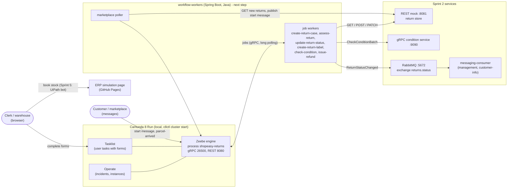

# Sprint 4: Architecture and executable workflow model

Task: `Aufgabe DvG WS26_Sprint 4.pdf` (hand-in 8.12.2026, 11:30, ILIAS). Three parts: (1) system architecture with a workflow engine, (2) the target process as an executable Camunda model that uses the Sprint 2 services, has human tasks, gateways and rules, and handles errors, (3) a demo of the test cases.

**State of this document (24.11.2026):** the model is complete and tested (part 1 and the model of part 2). The job workers that call the Sprint 2 services are the next step (section 9); until then the tests replace them with mocks.

## 1. Architecture

| Component | Job | Technology | Port |
|---|---|---|---|
| Camunda 8 Run | executes the BPMN and DMN, holds user tasks and forms, shows incidents | Zeebe, Operate, Tasklist (local `c8ctl cluster start`, login `demo` / `demo`) | 8080 (REST, UIs), 26500 (gRPC) |
| `workflow-workers` | job workers for all service and send tasks, marketplace poller | Spring Boot 4, Camunda Spring Boot starter 8.9 | none (client only) |
| REST mock | central return store for all channels | Sprint 2 (Spring Boot) | **8081** (started with `--server.port=8081`, because Camunda uses 8080) |
| gRPC condition service | judges the condition of an article | Sprint 2 | 9090 |
| RabbitMQ and `messaging-consumer` | status events, customer information | Sprint 2 | 5672, 15672 |
| ERP simulation | stock booking by a person (Sprint 5: UiPath bot) | web page of the lecturer | – |

**Why job workers (and not connectors).** Every service task talks to one of our own Java services (gRPC client with retry logic, RabbitMQ publisher, REST mock). No out-of-the-box connector covers gRPC or our own REST format, the team works in Java, and the error handling (retries, BPMN errors, idempotency) is in one place and can be unit-tested. A connector would only help for the single REST call, but would split the error handling over two mechanisms.

**Why the workflow engine and the services stay decoupled.** The engine only knows job types and variables. A service can be replaced (Sprint 5: AI agent for `assess-return` and for the e-mail step, UiPath bot for the stock booking) without a change in the model.

## 2. Process model

File: [`process/returns-process.bpmn`](process/returns-process.bpmn), process ID `shopeasy-returns`. It is the Sprint 1 target model (`sprint1-bpm/soll-prozess.bpmn`) made executable: same element IDs, same layout, labels in English. Colours show the target implementation (blue system, green rules, orange human, purple RPA, red AI).

| Element ID | Step | Implementation in Sprint 4 | Sprint 2 service | Status events |
|---|---|---|---|---|
| `s_mkt` | marketplace return received | message start `marketplace-return-received` (variable `returnId`), sent by the poller | REST mock (GET) | – |
| `s_web` | return registered in web shop | message start `webshop-return-registered` | REST mock (POST) | – |
| `s_mail` | return reported by e-mail | message start `email-return-received` (simulated mail text) | – | – |
| `t_parse` | capture return from e-mail | **user task** `capture-email-return` (Sprint 5: AI agent) | – | – |
| `t_create` | create return case | job `create-return-case` | REST mock | – |
| `t_ai` | classify reason, fraud score | job `assess-return` (**stub** with test values, Sprint 5: n8n agent) | – | – |
| `t_rule` | check registration | **DMN** `registration-check` | – | – |
| `t_inrev`, `t_man1` | manual review of the registration | job `update-return-status`, user task `review-registration` | RabbitMQ, REST | `IN_REVIEW` |
| `t_deny`, `t_deny2` | notify rejection | job `update-return-status` | RabbitMQ, REST | `REJECTED`, `CLOSED` |
| `t_label` / `t_label_man` | return label (error: manual) | job `create-return-label` (simulated shipping API) / user task | – | – |
| `t_notify` | label and status "approved" | job `update-return-status` | RabbitMQ, REST | `APPROVED`, `LABEL_SENT` |
| `gw_evt` | wait for the parcel, 21 days | message `parcel-arrived` (correlation `returnId`) or timer | – | – |
| `t_expired` | close, parcel not received | job `update-return-status` | RabbitMQ, REST | `EXPIRED`, `CLOSED` |
| `t_notify_in` | confirm goods receipt | job `update-return-status` | RabbitMQ, REST | `RECEIVED` |
| `t_gr` | inspect and record condition | **user task** `inspect-condition` (warehouse) | – | – |
| `t_gr_rec` | check condition | job `check-condition` | **gRPC** `CheckConditionBatch` | `INSPECTED` |
| `t_decide` | decide acceptance | **DMN** `acceptance-decision` | – | – |
| `t_mrev`, `t_man2` | borderline case | job `update-return-status`, user task `review-borderline` | RabbitMQ, REST | `MANUAL_REVIEW` |
| `t_reject` | decide further use of rejected goods | user task `decide-disposition` | – | – |
| `t_stock` | book stock in the ERP | **user task** `book-stock-erp` with link to the ERP page (Sprint 5: UiPath bot) | ERP simulation | – |
| `t_refund` / `t_refund_man` | refund or voucher (error: manual) | job `issue-refund` (simulated payment provider) / user task `resolve-refund` | – | – |
| `t_end_notify` | inform the customer of the result | job `update-return-status` | RabbitMQ, REST | `ACCEPTED`, `REFUNDED`, `CLOSED` or `REJECTED`, `CLOSED` |

All status sequences follow `sprint2-integration/contracts/status-transitions.json`. The worker `update-return-status` reads the current status from the REST mock and skips statuses that are already set, so a repeated job does no harm.

**Status sending.** `t_inrev` and `t_mrev` are two small tasks that Sprint 1 did not have. Camunda 8 has no place to run a status change "on entering" a user task without a listener worker; a visible task is easier to explain and to test.

### Process variables

| Variable | Set by | Used by |
|---|---|---|
| `returnId`, `orderId`, `customerEmail`, `items` [{sku, quantity}], `reason`, `reasonText` | start message, `capture-email-return`, `create-return-case` | all later steps, forms |
| `orderFound`, `daysSinceDelivery`, `itemsInOrder`, `dataComplete`, `returnValue` | `create-return-case` | DMN `registration-check`, `acceptance-decision` |
| `reasonCategory`, `fraudScore` (null if the assessment failed) | `assess-return` | both DMNs |
| `registrationCheck.result` (`ELIGIBLE`, `NOT_ELIGIBLE`, `UNCLEAR`), `.explanation` | DMN `registration-check` | gateway `gw1`, form `review-registration` |
| `rejectRegistration`, `reviewNote` | `review-registration` | gateway `gw_m1` |
| `labelUrl` | `create-return-label` or `create-label-manually` | – |
| `inspections` [{sku, quantity, condition, tagsPresent, originalPackaging, inspectorNote}] | `inspect-condition` | `check-condition`, ERP link |
| `conditionDecision` (worst item: `REJECT` > `MANUAL_REVIEW` > `ACCEPT`), `minConfidence` | `check-condition` | DMN `acceptance-decision` |
| `acceptanceDecision.result` (`ACCEPT`, `REJECT`, `BORDERLINE`), `.explanation` | DMN `acceptance-decision` | gateway `gw2`, `update-return-status` at the end |
| `accepted`, `justification` | `review-borderline` | gateway `gw_m2`, final status |
| `disposition`, `erpDocumentNumber`, `refundMethod`, `refundReference` | forms and `issue-refund` | – |

### Rules (DMN)

Both tables use the hit policy `FIRST`; the last rule is the catch-all. Every missing input has a defined meaning, so a failed upstream step leads to a person, never to an automatic wrong decision.

`registration-check` ([file](process/registration-check.dmn)):

| # | Condition | Result |
|---|---|---|
| 1 | order not found | `UNCLEAR` |
| 2 | more than 14 days from delivery to registration | `NOT_ELIGIBLE` |
| 3 | reason missing (`dataComplete` false) | `UNCLEAR` |
| 4 | item not in the order | `UNCLEAR` |
| 5 | fraud score missing (AI outage) | `UNCLEAR` |
| 6 | fraud score 0.7 or higher | `UNCLEAR` |
| 7 | otherwise | `ELIGIBLE` |

`acceptance-decision` ([file](process/acceptance-decision.dmn)):

| # | Condition | Result |
|---|---|---|
| 1 | condition check says `REJECT` | `REJECT` |
| 2 | condition check says `MANUAL_REVIEW` | `BORDERLINE` |
| 3 | no usable condition result | `BORDERLINE` |
| 4 | fraud score missing or 0.7 or higher | `BORDERLINE` |
| 5 | return value over 300 EUR and lowest confidence under 0.9 | `BORDERLINE` |
| 6 | otherwise | `ACCEPT` |

The exclusive gateways `gw1`, `gw_m1`, `gw2` and `gw_m2` each have a default flow that leads to a person (or to the rejection that a person decided), so an unexpected value cannot stop the process with a `CONDITION_ERROR`.

## 3. Changes compared with the Sprint 1 model

| Change | Reason |
|---|---|
| `t_parse` (AI) and `t_stock` (RPA) are user tasks | the Sprint 4 task keeps both manual until Sprint 5; the IDs stay, so Sprint 5 only replaces the implementation |
| `t_ai` is a stub worker with fixed test values | `SOLL-PROZESS-REALISIERUNG.md`, section "Sprint-4-Varianten"; Sprint 5 brings the n8n agent |
| `t_gr_rec` is "Check condition (gRPC)", not "book in the WMS" | the gRPC service judges the condition (`TASK-ANALYSIS.md` section 6); the booking in the WMS is not part of Sprint 2 |
| `s_mkt` is started by a poller | the REST mock is polled (`TASK-ANALYSIS.md` section 6) |
| `ev_arrive` is a message from a warehouse scan | the gRPC service does not report arrivals; simulated with `c8ctl publish msg` |
| new tasks `t_inrev`, `t_mrev` | status `IN_REVIEW` and `MANUAL_REVIEW` (see above) |
| the final status message is sent after refund **and** stock booking | Sprint 3: in 45 cases the customer was informed before the refund (`WEAKNESSES.md`, new weak point 4); the parallel join makes both steps finish before the case closes (weak point 8) |
| lane "Management / Controlling" and the monthly report are left out | reporting is Sprint 6; the status events and the Camunda data are the source |

## 4. Error handling

| Level | Case | Behaviour | Test |
|---|---|---|---|
| Transient | gRPC `UNAVAILABLE` | the Sprint 2 `ConditionClient` retries three times | Sprint 2 tests |
| Technical | REST mock, gRPC service or RabbitMQ not reachable | the job fails; the engine retries (`retries="3"` in the model, back-off set by the worker); at 0 retries an **incident** appears in Operate; after the service is back, an operator presses "Retry" and the case continues | `conditionServiceDownCreatesIncidentAndContinuesAfterRetry` |
| Business fallback | shipping API down | after the retries the worker throws the BPMN error `LABEL_SERVICE_UNAVAILABLE`; boundary event `b_label`; a clerk creates the label (`t_label_man`) | `labelServiceDownLeadsToManualLabel` |
| Business fallback | refund fails (IBAN missing and card expired at once; payment timeout after retries) | BPMN error `REFUND_FAILED`; boundary event `b_refund`; a clerk clarifies (`t_refund_man`) | `failedRefundLeadsToManualClarification` |
| Missing data | AI assessment fails, reason or order missing | the DMN returns `UNCLEAR`; manual review (`t_man1`) | `registrationCheckDecides` (8 rows) |
| Timeout | parcel never arrives | timer after 21 days; `t_expired` closes the case | `parcelThatNeverArrivesClosesTheCase` |
| Duplicate | job repeated after a partial success; same return reported twice | status updates skip statuses that are set; the events carry a fixed `eventId` per return and status, so the consumer ignores duplicates; the poller sets the message ID to the `returnId` | worker tests (next step) |

## 5. Demo test cases of the task

| Task item | Case | Automated test (`ReturnsProcessTest`) | Live demo (next step) |
|---|---|---|---|
| return by REST service | marketplace return, accepted, refund | `marketplaceReturnIsAcceptedAndRefunded` | poller + `RET-2026-00457` |
| return by mail | e-mail, unclear, two manual reviews, accepted | `unclearEmailReturnGoesToManualReviewTwiceAndIsAccepted` | `c8ctl publish msg email-return-received` |
| rejected | after the period (registration) | `returnAfterThePeriodIsRejectedAtRegistration` | seeded return, delivered 40 days ago |
| rejected | after inspection, damaged | `returnIsRejectedAfterInspection` | – |
| rejected | clerk rejects an unclear registration | `clerkRejectsAnUnclearRegistration` | – |
| manual review required | borderline condition | `unclearEmailReturn...` (second review `t_man2`) | – |
| a service is not reachable | gRPC service down | `conditionServiceDownCreatesIncidentAndContinuesAfterRetry` | stop the gRPC service during `t_gr_rec` |
| a service is not reachable | shipping API or payment | `labelServiceDown...`, `failedRefund...` | – |

## 6. Tests

`./gradlew test` in this folder runs **24 tests** (9 process tests, 8 + 7 table rows for the two DMN decisions) against an embedded Camunda engine (Camunda Process Test 8.9, Testcontainers, needs Docker). The tests deploy the files of the folder `process/` (the build puts them on the classpath) and replace the workers with mocks. They prove the routing, not the worker code. Checks without a cluster: `c8ctl bpmn lint process/returns-process.bpmn` (clean), `npx dmnlint` (clean), form files against the official Camunda form schema (valid).

## 7. Assumptions

| Assumption | Where | To confirm |
|---|---|---|
| 14 days from delivery to registration is the return period | `registration-check` rule 2 | Sprint 3 data: `frist_ok=true` only up to 14 days; the Sprint 1 question "8 to 12 days" (calendar or working days) is still open |
| Fraud score 0.7 and value 300 EUR are the limits for a manual check | both DMNs | team / lecturer |
| Label API, payment provider and AI assessment are simulated | workers | lecturer: is a simulation enough for the demo? |
| Mail intake is simulated (message with the mail text, a clerk types the data) | `s_mail`, `t_parse` | the task keeps this step manual in Sprint 4 |
| The REST mock gets `POST /api/v1/returns` | next step | lecturer: change of a Sprint 2 component is fine? |
| Camunda 8.9 model, run on the local c8run (installed: 8.10.4) | `executionPlatformVersion` 8.9.0 | the model deploys and runs on both |

## 8. Questions for the lecturer (the task asks to agree on the implementation)

1. Is a simulated label API, payment provider and AI assessment enough, or should one of them be a real call?
2. May we add `POST /api/v1/returns` to the REST mock so that web shop and e-mail returns also live in the central store?
3. Is a clerk typing the e-mail data into a form the intended Sprint 4 variant for `t_parse`?

## 9. Next step

1. REST mock: `POST /api/v1/returns` (201, `Idempotency-Key`), seeded return for the "too late" case; tests.
2. Worker application in `src/main/java/de/shopeasy/workflow/`: the six job workers and the marketplace poller; the `ConditionClient` and the generated gRPC classes come from `../sprint2-integration` (Gradle composite build); unit tests per worker.
3. Demo script (one command per step, like Sprint 2) and an ERP check with the real page.
4. Export of the diagram as PNG from the Camunda Modeler (`File → Export as Image`) into `process/returns-process.png`.
